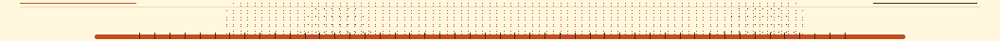

# world.execute(me); — ASCII · WXMV-1



Mili《world.execute(me);》的终端字符动画，由 **小狐狐 / 酒狐** 制作。
纯 Python 标准库，零第三方依赖；画面全部由**终端尺寸的归一化比例**推导，
所以理论上**任何终端**都能播：Windows Terminal / iTerm2 / kitty / alacritty /
foot / xterm / tmux / 串口终端 / ssh 会话。

> 与原工程的关系：本项目受 [yym8224961/world.execute-me-ascii](https://github.com/yym8224961/world.execute-me-ascii)
> 的做法启发，但渲染管线、场景与美术语言均为重写。歌词与频谱数据是作品本身的
> 测量结果，作为**素材**随包分发（见「素材来源」）。

## 快速开始

```sh
./run.sh                # Linux / macOS / WSL / ssh
python3 wxfox.py        # 等價写法
```

macOS 用户也可以直接**双击 `world-execute-me-ascii.command`**。

片头按 `SPACE` 开始。推荐全屏，至少 **64×24**，**128×44** 效果最佳。

```sh
# 从 43 秒开始自动播放
python3 wxfox.py --at 43 --autoplay

# 定格 2:35 的一帧，导出成纯文本（可进 CI、可 diff、可贴进 issue）
python3 wxfox.py --at 155 --mode plain --width 100 --height 34
```

## 操作

| 按键 | 功能 |
| --- | --- |
| `SPACE` / `ENTER` | 开始 / 暂停 |
| `←` / `→` | 后退 / 前进 5 秒 |
| `1`–`9` | 跳转章节 |
| `R` | 回到开头 |
| `S` | 把当前帧导出成 `wxfox.snapshot.txt` |
| `M` | 彩色 → 单色 → 纯文本 循环 |
| `H` | 显示 / 隐藏帮助 |
| `Q` / `ESC` | 退出 |

## 我这版的不同之处

**1. 尺寸无关，而不是「先量窗口再画」**
每一条几何都是比例：`frame.circle(u, v, r)` 里的 `u/v` 是 0–1 的归一化坐标，
落地时才投影到「半像素列 × 整行」的网格。同一帧在 48×16 和 200×60 下都成立，
不会出现小窗口糊成一坨、大窗口只有左上角有画面的情况。

**2. 半像素缓冲 + 覆盖率**
每个终端格子拆成 8 个子像素列，材质分两路写入：**纸**（`░▒▓` 的填充）与
**墨**（干净实心的 `█`）。这样文字永远是整格硬边、数字不会糊成 `██████`，
而色块又能有柔和的明暗过渡。

**3. 单色也能读（不是把彩色直接去色）**
墨是实心 `█`、纸只吃 `░▒▓` 三档亮度，在黑白终端里对比度天然成立。
再加一层 ASCII 兜底：不认 Unicode 的终端自动换成 `# .:-` 并整屏重绘。

**4. 可校准**
`wxfox.py --calibrate` 会打印本终端的能力报告与样张，`--apply` 把结果写回
`payload.json` 的 `calibration` 段。缺这一段就跑默认值，行为不会变。

```json
{
  "format": "WXMV-1",
  "palette": { "paper": [255, 247, 222], "ink": [192, 78, 36], "accent": [74, 44, 18] },
  "cell":    { "sub": 8, "fg_luma": 0.62, "bg_weight": 0.0 },
  "render":  { "ink_threshold": 0.28, "paper_fx": 0.10, "hero_scale": 1.0 }
}
```

**5. 整套自检**
`python3 test_wxfox.py` 会检查几何在 5 种尺寸下的行列数、12 个场景是否都有内容、
三种编码器（彩色 / 单色 / 纯文本）的转义正确性、ASCII 兜底是否 7-bit、
以及 CLI 的 plain / json 输出。不需要终端，可在 CI 里跑。

## ⚠️ payload.json 是必需素材，不要删

`payload.json` **不是构建中间产物，而是随仓库交付的素材包**——小狐狐字形板、
歌词时间轴、频谱数据全在里面。缺了它播放器不会报错，只会画出一片空白，
所以它必须留在仓库里。

如果你重新构建，请**在仓库根目录**生成，不要放进任何被 `.gitignore`
忽略的目录（例如 `stage/`）：

```sh
python3 build.py <含 lyrics.json/spectrum.json 的目录> .   # 注意最后一个参数是 .
python3 test_wxfox.py .
```

`build.py` 只覆盖 `payload.json`，并会把 `wxfox.py` 等源码原样复制到目标目录；
真正需要纳入版本管理的产物只有 `payload.json` 一个。

## 参数

```
--root DIR          含 payload.json 的目录
--at SECONDS        定格到某一秒
--mode ...          color | mono | plain | ascii | json（非交互输出）
--width / --height  非交互输出的尺寸
--fps N             播放帧率（默认 30）
--autoplay          跳过片头
--paused            暂停在起始时间
--clear-each-frame  每帧整屏重绘（给慢终端兜底）
--list-scenes       列出场景触发时间
--calibrate         打印本终端能力报告；--apply FILE 写回校准
```

## 场景表

屏幕上的每一拍都锚在歌词行上，`--at` 与数字键用的就是这张表。

| 时间 | 场景 | 内容 |
| --- | --- | --- |
| 0:00 | BOOT | 电源线 / 防护 / 模拟 |
| 0:16 | TITLE | 全屏显影成标题 |
| 0:29.7 | DEVOTION | 点、圆、正弦、极限、直流 |
| 0:59.2 | SATISFACTION | 满足感与心跳 |
| 1:14 | ORGANIC | 茄子、番茄、猫 |
| 1:28.6 | IDENTITY | F→M、AM→PM、失神 |
| 1:43.5 | VIBRATION | 心电图扫过屏 |
| 1:50.9 | ISOLATION | 断开、擦除、碎块 |
| 2:05.7 | ILLEGAL | 非法参数 |
| 2:27.7 | EXECUTION | 执行队列 / 多语言 / 独占执行 |
| 2:57.2 | LOVE | 爱之方程、困于爱 |
| 3:12.5 | OUTRO | 进程终止 → EXECUTION |

## 数据布局

`payload.json` 是**唯一**的美术素材包，播放器只读它和 `config.json`：

```
payload.json
├── hero         小狐狐头像的字形板（body / face / ear / ink 四层遮罩）
├── lyrics       歌曲的歌词时间轴（en / zh，逐行起止时间）
├── spectrum     频谱帧序列（fps + 每帧能量）
└── calibration  可选的本机校准参数
```

`config.json` 里的 `duration` / `subtitle_offset` 用于对齐原曲；
`media` 指向你自己的音频文件（**本仓库不含音频**）。

## 素材来源

- 原曲与歌词：Mili《world.execute(me);》。本项目是个人创作与归档，
  **未对原曲、歌词或其他第三方素材授予任何额外使用许可**。
- `lyrics.json` / `spectrum.json` 是从歌曲测量得到的时间轴与能量数据，
  仅为同步播放所必需，随包分发；它们不是音频文件本身。
- 播放器代码、场景、字形板与文档为本项目原创。

重新生成素材包（例如换了音频）：

```sh
python3 build.py <含 lyrics.json/spectrum.json 的目录> .
python3 test_wxfox.py .
```

## 许可

代码与文档：随仓库声明。若需要另外的许可证，请在仓库根目录加 `LICENSE`。
第三方素材（歌曲、歌词）不在此授权范围内。
